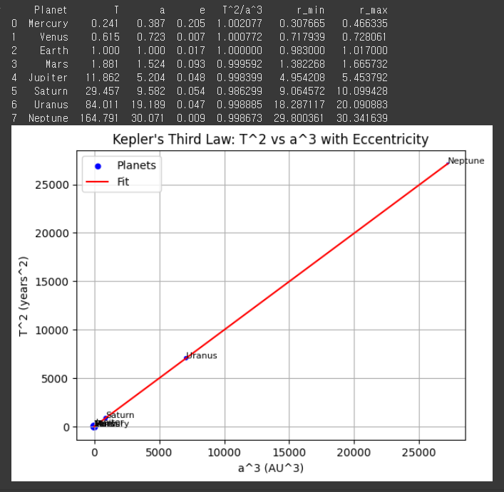
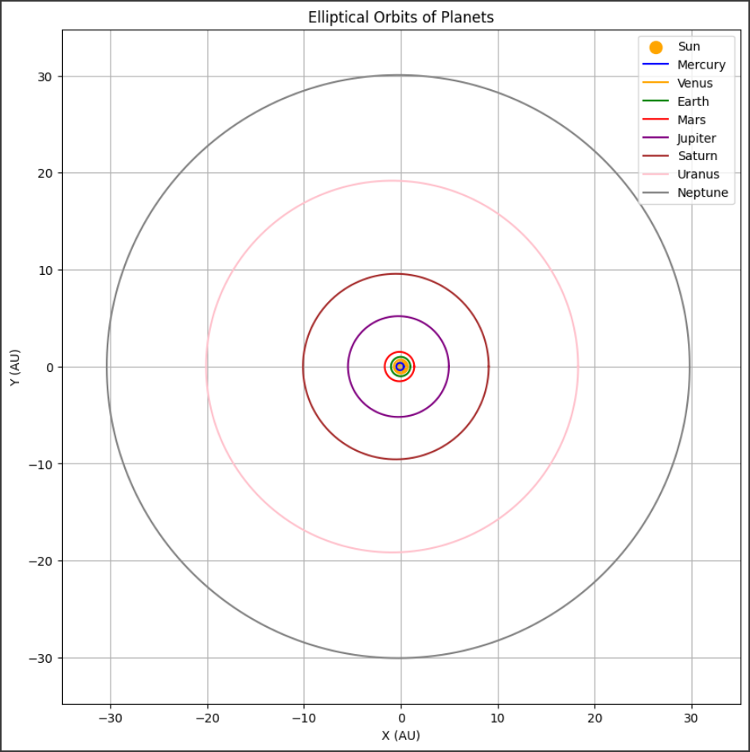

# 케플러 제3법칙과 행성 궤도

태양계 8개 행성의 공전 주기(T), 긴반지름(a), 이심률(e) 데이터로
**케플러 제3법칙(T² ∝ a³)** 을 확인하고, 각 행성의 타원 궤도를 그렸습니다.

- 언어/라이브러리: Python, NumPy, pandas, Matplotlib
- Claude AI는 github 정리에만 사용, 코드 작성에는 미사용함.

```
src/
  kepler_third_law.py    # T²/a³ 계산, 근일점·원일점 거리, T² vs a³ 그래프
  elliptical_orbits.py   # 극좌표 궤도 방정식으로 8개 행성의 타원 궤도 그리기
results/
```

## 1. 케플러 제3법칙

`src/kepler_third_law.py`

- T²/a³ 비율과 근일점 `a(1−e)`, 원일점 `a(1+e)` 계산
- T² vs a³ 산점도 (점 크기 = 이심률) 위에 평균 비율로 만든 직선을 겹쳐 그림



**결과:** 모든 행성에서 T²/a³ 값이 약 1.00(단위: 년², AU³)으로 나와 제3법칙이 성립함을 확인했습니다.

## 2. 행성의 타원 궤도

`src/elliptical_orbits.py`

- 궤도 방정식 `r(θ) = a(1−e²) / (1 + e·cosθ)` 를 직교좌표로 바꿔 그림 (태양은 초점)



## 실행 방법

```bash
pip install -r requirements.txt
python src/kepler_third_law.py
python src/elliptical_orbits.py
```
